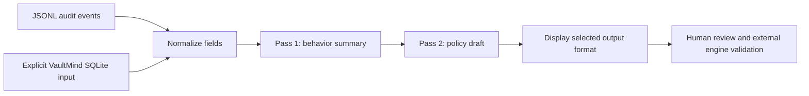

# LogPolicySmith

A Python CLI experiment that reads agent audit events, summarizes behavior with an LLM, and asks a second LLM pass to draft a policy. Output targets include Rego, CEL, generic YAML and a VaultMind-style YAML structure.

**Generated output is a policy draft requiring human review and engine-specific validation.** This repository does not establish that a generated policy is safe, complete or ready to enforce.

## Data flow



`--mock` replaces both model passes with fixed demonstration content. It exercises the CLI/formatting path; it does not infer a policy from the supplied events.

## Install and try without a model

Python 3.9+ is declared by `pyproject.toml`. From a source checkout:

```sh
python -m venv .venv
# Windows PowerShell:
.venv\Scripts\Activate.ps1
# macOS/Linux instead: source .venv/bin/activate
python -m pip install -e .
python -m src.cli generate --input tests/resources/sample_logs.jsonl --mock --format yaml
```

Installation downloads declared dependencies. The mock command does not call a model, use credentials or access a personal audit database. It prints a Rich panel to the terminal, rather than writing a deployable policy file.

Actual mock-command excerpt, captured on 9 November 2026:

```text
[OK] Loaded 4 events from tests/resources/sample_logs.jsonl.
[MOCK] Simulating behavior summarization...
[OK] Behavior summary successfully generated (mock).
[MOCK] Synthesizing security policy...
[OK] Policy successfully generated (mock).

package: agent.policy
allows:
- action: read
  tool: file_reader
  path_prefix: /data/approved/
- action: write
  tool: file_writer
  path_prefix: /data/output/
denies:
- action: exec
  tool: terminal_runner
```

The YAML excerpt is the contents of the output panel. It is an application example, not an enforcement result. This CLI has no graphical application screen; the real command output and architecture diagram visualize its implemented flow.

## Model-backed generation

`config/default.yaml` selects the provider, model, endpoint and default output format. Source-backed options are available with:

```sh
python -m src.cli generate --help
```

- `--provider ollama` uses a separately running Ollama server and a model you have installed. Local model execution was not tested in this audit.
- `--provider nvidia` reads `NVIDIA_API_KEY`; `--provider openai` reads `OPENAI_API_KEY`. Those modes send the prepared event context and summary to the configured remote endpoint and may incur charges. The configured model names are defaults in this repository, not a claim of current provider availability.
- `--model`, `--host` and `--format` override selected defaults. Prefer environment variables to passing API keys in shell arguments.
- `--vaultmind --db-path /path/to/audit.db --days 7` reads the expected `audit_log` schema. Without an explicit path it looks under the current user's `.vaultmind` directory. Use only a database you are authorized to inspect.

Normalization retains each original event in `metadata`. The model context includes resource names and the first five normalized events, including that metadata. There is no automatic secret or personal-data redaction. Sanitize inputs before using any provider, and review the endpoint before sending private logs.

## Source and checks

- `src/cli.py`: input selection, configuration, mock mode and the two generation passes.
- `src/ingester/`: JSONL parsing and normalized event model. Malformed JSON lines are skipped; parsed non-object records are not comprehensively validated.
- `src/integrations/vaultmind.py`: SQLite event retrieval. Connections now close on success, missing-table and failed-query paths.
- `src/summarizer/` and `src/generator/`: provider adapters and prompt loading.
- `src/output/`: structured demonstration formatters.
- `src/validator/policy_tester.py`: optional OPA syntax-check helper and a keyword-based historical-log simulation. The normal generate command does not invoke them.

```sh
python -m pip install pytest
python -m pytest tests -q
```

Six offline tests passed on 9 November 2026: three existing ingestion/normalization tests and three real temporary-SQLite lifecycle cases. Before repair, the missing-table and failed-query cases leaked their connections; both regressions failed. No real user database, cloud provider, Ollama model or policy engine was invoked. The local mock smoke used available imports; a fresh full dependency install and installed-wheel behavior remain unverified.

## Limits before enforcement

- A model response is returned as text without schema, syntax or decision validation. Logs can contain adversarial instructions, and observed actions do not automatically imply authorized actions.
- The CEL demonstration formatter ignores deny rules. Rego emits separate allow/deny rules without combining them into a deny-overrides decision and uses syntax that must be checked against the intended OPA version. String values are interpolated without comprehensive escaping.
- The VaultMind formatter's pattern expansion and schema compatibility have not been integration-tested against a particular VaultMind version. Generic YAML is only a structured draft.
- The historical-log helper uses keyword checks; it is not an OPA/CEL evaluator or a policy correctness test. The OPA helper is not called by the CLI and still uses a shared temporary filename and shell invocation.
- Some CLI error paths print a message and return a successful exit status. Config/prompt packaging and fallback behavior need installed-package checks. Do not treat a zero exit status as proof that a valid policy was generated.
- JSONL input is eventually collected into memory, and representative events/resources are truncated in the prompt. No scale benchmark or regulatory compliance is established.

## Repair and rollback

This repair adds unconditional SQLite connection cleanup, three regression cases, a truthful offline example, and an updated description of generation and enforcement limits. Revert the repair commit through normal Git history to undo it. The existing license is in `LICENSE`.
